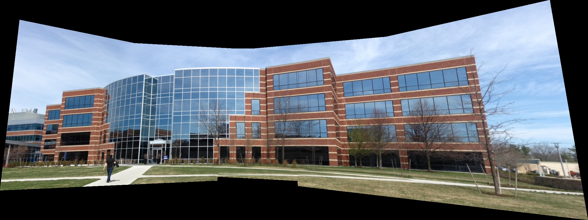
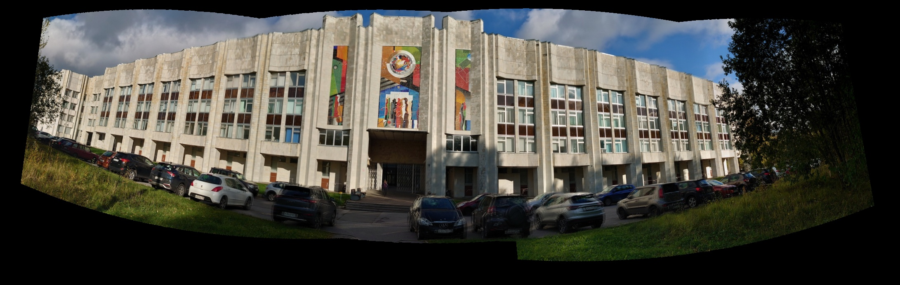
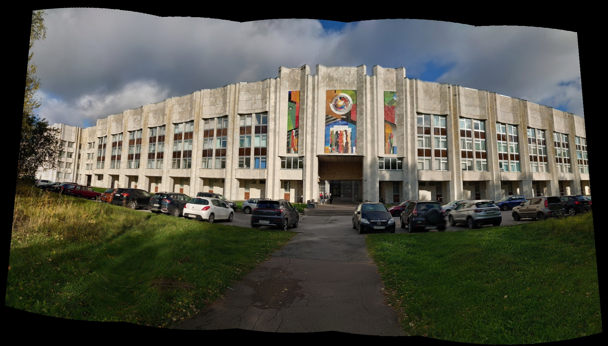

# Компьютерное зрение — домашняя работа №4

Сшивка трёх наборов изображений в панорамы по алгоритму из `lab04_2`:
ORB → BFMatcher (Hamming) → ratio test → гомография RANSAC → `warpPerspective`.
Кадры совмещаются относительно среднего, перекрытия плавно смешиваются.
Для широких панорам building2 и building3 предварительно применяется
цилиндрическая проекция с приближённым фокусным расстоянием.

Запуск:

```bash
pip install -r requirements.txt
python main.py
```

Исходные изображения находятся в `hw4/`, результаты — в `results/`.
Из-за параллакса и движения объектов возможны небольшие двоения,
особенно около автомобилей. Чёрные области по краям — вне покрытия кадров.

### building1 — 5 кадров



### building2 — 4 кадра



### building3 — 5 кадров


